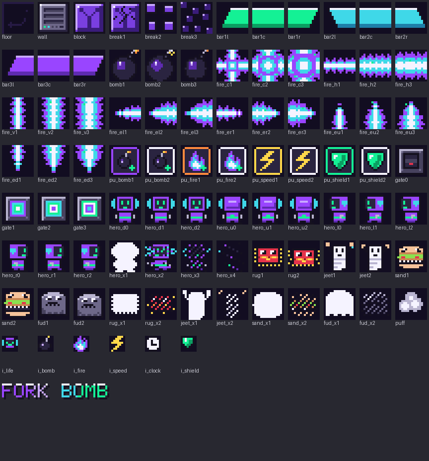

# FORK BOMB

A bomb-maze arcade game for the Solana Breakpoint 2026 badge (ESP32-C5, Solana OS 2.x, Lua).
Blow up forks, dodge the rugs, jeets and MEV sandwiches, and reach the Finality gate.


## The game

- 15 x 13 tile maze, 16 px pixel-art tiles, drawn on one canvas. Hero and foes are sprites on top.
- 8 stages across 4 worlds: DEVNET, TESTNET, MAINNET, BREAKPOINT. Each world has its own colours.
- On the "logo" stages the indestructible walls in the middle form the three Solana bars.
- Clear every foe to open the Finality gate. It hides under one of the fork blocks.
- After stage 4-2 a new epoch starts and the foes get faster.

| Foe | Behaviour | Points |
|---|---|---|
| RUG | slow, wanders | 100 |
| JEET | fast, panics and turns at random | 200 |
| SANDWICH | MEV bot, charges when it sees you in a line | 400 |
| FUD | drifts through fork blocks, drawn towards you | 800 |

Several kills from one blast double each time (x2, x4, ...).

| Power-up | Effect |
|---|---|
| +1 BOMB | one more bomb at a time (max 8) |
| +1 RANGE | longer flames (max 8) |
| IBRL | speed up (max 3) |
| SHIELD | 10 s immune to foes and fire |

Bombing the open gate lets FUD out. Time runs out after 200 s. 3 lives. The best score and the
stage reached are saved; CONTINUE starts there with some firepower.

LEDs: the top six show the fuse of the next bomb, flash on blasts, chase green when the gate is
open; the two on the right edge show lives.

Controls: D-pad move, SELECT bomb, CANCEL pause (CANCEL again quits to the menu).


## Files

| Path | What |
|---|---|
| `app.json` | Manifest: id `forkbomb`, permission `led` only |
| `main.lua` | The game |
| `art.lua` | All sprites as pixel-art rows. Generated, do not edit by hand |
| `tools/art.py` | Art source: palette, world colours, every sprite. Writes `art.lua` and a preview sheet |
| `tools/sim.py` | Headless runner: a Python mock of the badge Lua API, a bot that plays, an instruction counter per callback and PNG screenshots |
| `tools/bundle.py` | Packs the app as gzip+base64 for pasting into the emulator page |
| `docs/` | Sprite sheet and screenshots |



## Develop

```bash
python3 tools/art.py                       # after changing art
python3 -m venv .venv && .venv/bin/pip install lupa pillow
.venv/bin/python tools/sim.py --seconds 120 --shots tools/out/run --every 3000
```

`sim.py` runs Lua 5.4 (the badge runs 5.5; the code avoids the differences). It prints the most
VM instructions any callback used (the badge allows 200 000) and fails on any Lua error.

On the real firmware: open https://solana.com/breakpoint/badge/emulator, open the Console, send
`open home` first (the badge refuses `lua put` while the app runs, and the old file stays), then
send `lua put forkbomb <file> begin`, base64 lines of up to 128 chars, `lua put forkbomb <file> end`
for `app.json`, `art.lua` and `main.lua`, then `lua run forkbomb`. `key select` / `key up` drive it
(taps only, no hold). `lua mem` shows heap and errors.

Publish: https://solana.com/breakpoint/badge/apps/submit, drop the folder (app.json, main.lua, art.lua).

## Limits it respects

- Under 128 UI objects (about 30 in play), 200 000 instructions per callback (about 31 000 worst case in the sim)
- One canvas for the map, redrawn per changed tile only; sprites move with `image:pos`
- No network, no keys, no real value

## License

MIT
