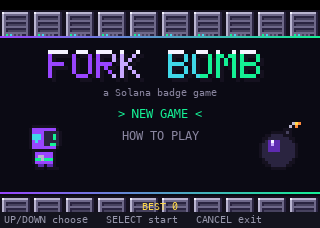
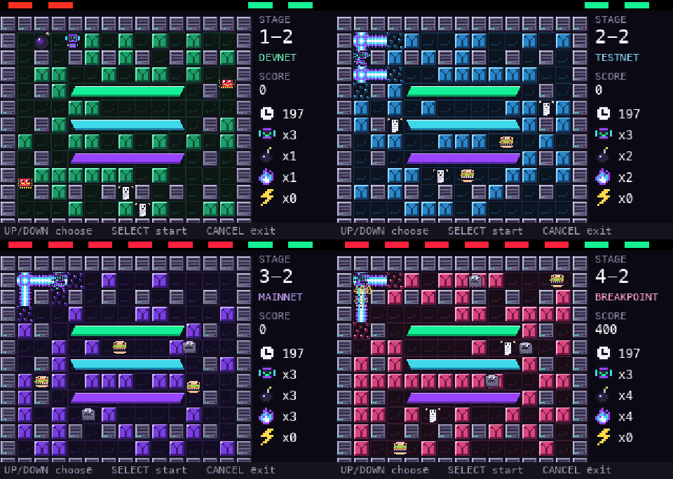

# FORK BOMB

A bomb-maze arcade game for the Solana Breakpoint 2026 badge (ESP32-C5, Solana OS 2.x, Lua).
Blow up forks, dodge the rugs, jeets and MEV sandwiches, and reach the Finality gate.



## The game

- 15 x 13 tile maze, 16 px pixel-art tiles, drawn on one canvas. Hero and foes are sprites on top.
- 8 stages across 4 worlds: DEVNET, TESTNET, MAINNET, BREAKPOINT. Each world has its own colours.
- Every stage has a picture made of breakable blocks in the middle: 1-1 the Solana logo (three
  bars), 1-2 "00" for DoubleZero, then GM, SOL, LFG, TPS, BP, and the Solana logo again on 4-2.
  Picture blocks hide power-ups more often.
- Clear every foe to open the Finality gate. It hides under one of the blocks.
- After stage 4-2 a new epoch starts and the foes get faster.

| Foe | Behaviour | Points |
|---|---|---|
| RUG | slow, wanders | 100 |
| JEET | fast, panics and turns at random | 200 |
| SANDWICH | MEV bot, charges when it sees you in a line | 400 |
| FUD | drifts through fork blocks, drawn towards you | 800 |

Several kills from one blast double each time (x2, x4, ...).

About one fork in five hides a power-up (one in three in the picture), plus one fixed per stage:

| Power-up | Effect | From stage |
|---|---|---|
| +1 BOMB / +1 RANGE | one more bomb, longer flames (max 8) | 1 |
| IBRL | speed up (max 3) | 1 |
| SHIELD | 10 s immune to foes and fire | 1 |
| +30 SLOTS | 30 s more on the clock | 1 |
| KICK | walk into a bomb to send it sliding | 1 |
| AIRDROP | +1 life | 2 |
| FIREDANCER | flames go through forks | 2 |
| REMOTE | bombs wait; hold SELECT to set them off | 3 |
| MAX TPS | full range at once | 3 |
| ZK PASS | walk through forks | 3 |
| OUTAGE | a curse for 8 s: slow, no bombs or flipped D-pad | 3 |

Losing a life loses KICK, REMOTE, FIREDANCER, ZK PASS and one speed level.
Bombing the open gate lets FUD out. Time runs out after 200 s. 3 lives. The best score and the
stage reached are saved; CONTINUE starts there with some firepower.

LEDs: the top six show the fuse of the next bomb, flash on blasts, chase green when the gate is
open; the two on the right edge show lives. They can be turned off in SETTINGS.

Controls: D-pad move, SELECT bomb (hold it with REMOTE), CANCEL pause (CANCEL again quits).

Menu: NEW GAME, CONTINUE, LEADERBOARD, HOW TO PLAY (3 pages), SETTINGS (LEDs, name on the
board, reset progress).

## 1.1.0 (23 Nov 2026)
- The Finality gate breaks out of its fork when the last foe dies (before, a gate still under a
  fork stayed hidden, so the stage looked stuck).
- SECRETS on the title: hints for the 5 secrets (IBRL MODE, TRIBUTE SKINS, GM, PROOF OF HISTORY,
  WAGMI), the how once found. Each pays 1 !LAMP once ever; all five pay 3 more and unlock GOLD VAL
  (gold hero, in the skin cycle). Daily awards are marked paid only when the server pays.
- Tests: tools/test_secrets.py (gate on all 8 stages, finds, payouts, capped day, X not linked).

## Leaderboard

`server/` is a Cloudflare Worker with a D1 table, live at https://forkbomb-scores.hypnogaba.workers.dev.
The badge sends its best score after each game (`POST /score`) and reads the top 10 plus the
player's rank (`GET /top`). Every request goes through the badge server, which signs it with
Ed25519 (`X-Badge-*` headers); the worker checks the signature, the app id, the time and replays,
so scores cannot be posted from a script. Unsent scores are kept and retried from the menu; a 4xx
is final. The name shown is the badge owner's X handle, or `anon` (SETTINGS).

```bash
node --experimental-sqlite server/test.mjs          # signs requests with its own key, SQLite as D1
cd server && npx wrangler@3 deploy                    # deploy
```

## !LAMP rewards

Each once per day, at most 15 !LAMPs a day per player:

| Earn | !LAMPs |
|---|---|
| First clear of each stage (8 stages) | 1 each |
| Finishing stage 4-2 in a run that started at 1-1 (a CONTINUE at 4-2 does not count) | 5 |
| A new best score | 2 |

Replays of a cleared stage earn nothing that day. Offline or busy answers are retried on the next
clear; an answer that arrives after midnight does not use up the new day; players without X linked
get one hint and no further requests that session; badges without a synced clock are limited to once
per session. `lamps.award` pays nothing until the organisers set the app's award cap.
A new best is rewarded at game over, at the end of an epoch and on quit from the pause menu, not on HOME.



## Files

| Path | What |
|---|---|
| `app.json` | Manifest: id `forkbomb`, permissions `led`, `lamps`, `http` (host: the leaderboard) |
| `main.lua` | The game |
| `art.lua` | All sprites as pixel-art rows. Generated, do not edit by hand |
| `tools/art.py` | Art source: palette, world colours, every sprite. Writes `art.lua` and a preview sheet |
| `tools/sim.py` | Headless runner: a Python mock of the badge Lua API, a bot that plays, an instruction counter per callback and PNG screenshots |
| `tools/test_items.py` | Checks power-ups, abilities and the picture stages |
| `tools/test_board.py` | Checks how scores are sent and retried |
| `server/` | Leaderboard worker, schema and its tests |
| `tools/test_lamps.py` | Checks the !LAMP rules: once a day, retries, X linking, midnight, CONTINUE, no clock |
| `tools/bundle.py` | Packs the app as gzip+base64 for pasting into the emulator page |
| `docs/` | Sprite sheet and screenshots |


## Develop

```bash
python3 tools/art.py                       # after changing art
python3 -m venv .venv && .venv/bin/pip install lupa pillow
.venv/bin/python tools/sim.py --seconds 120 --shots tools/out/run --every 3000
```

`sim.py` runs Lua 5.5, like the badge. It prints the most
VM instructions any callback used (the badge allows 200 000) and fails on any Lua error.

On the real firmware: open https://solana.com/breakpoint/badge/emulator, open the Console, send
`open home` first (the badge refuses `lua put` while the app runs, and the old file stays), then
send `lua put forkbomb <file> begin`, base64 lines of up to 128 chars, `lua put forkbomb <file> end`
for `app.json`, `art.lua` and `main.lua`, then `lua run forkbomb`. `key select` / `key up` drive it
(taps only, no hold). `lua mem` shows heap and errors.

Publish: https://solana.com/breakpoint/badge/apps/submit, drop the folder (app.json, main.lua, art.lua).

## Limits it respects

- Under 128 UI objects (about 30 in play), 200 000 instructions per callback (about 31 000 worst case in the sim)
- One canvas for the map, redrawn per changed tile only; sprites move with `image:pos`
- No keys or real value on the badge; http only to the leaderboard; `lamps.award` for in-game !LAMPs

## License

MIT
